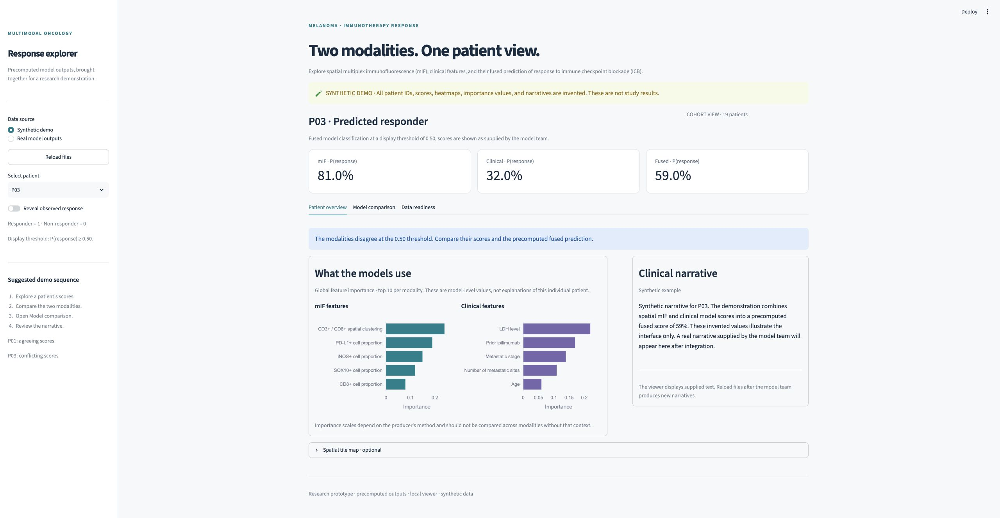

# Melanoma Response Explorer

A Streamlit research demo for viewing precomputed predictions of melanoma response to immune checkpoint blockade (ICB). It brings together spatial multiplex immunofluorescence (mIF), clinical model scores, a fused score, global feature importance, ROC comparisons, and a pre-generated clinical narrative.

The UI is a viewer. The model team supplies predictions and narratives; it does not train models or run NVIDIA NIM inference. The optional tile map can be omitted without affecting the main demo.



## Run the demo

Use Python 3.11 or newer. From the repository root:

```bash
python -m venv .venv
source .venv/bin/activate
pip install -r requirements.txt
streamlit run src/app.py --server.port 8501
```

Open the local address printed by Streamlit. On Windows, activate with `.venv\Scripts\activate`.

The app starts in **Synthetic demo** mode. All 19 patient IDs, scores, labels, feature importance values, tile maps, and narratives are invented fixtures. They do not represent study findings. Switching patients or reloading files leaves the fixture scores unchanged.

Try P01 for agreeing model scores, then P03 for conflicting scores. Toggle **Reveal observed response** to display the label. Open **Model comparison** to see three ROC curves, and expand **Spatial tile map** to inspect the optional map. P01 has two synthetic slides to demonstrate slide selection.

## Connect real results

Khai can clone this repo into the environment where model outputs are available. Put the agreed files under `results/predictions/`, select **Real model outputs**, and click **Reload files**. Real files are kept local and are ignored by Git.

```text
results/predictions/
  patient_predictions.csv    # required
  feature_importances.json   # optional until available
  narratives.json            # optional until available
  tile_predictions.csv       # optional
```

There is no automatic fallback from real outputs to synthetic data. A missing or invalid patient prediction file blocks the real-data view. Missing or invalid optional files leave their panels empty and appear in **Data readiness**. Files are reread on interaction and on reload; no result cache needs to be cleared.

See [the data contract](docs/DATA_CONTRACT.md) for exact schemas and [Khai's handoff](docs/KHAI_HANDOFF.md) for integration steps and acceptance checks.

## Run on HPC

Start Streamlit inside the allocated compute environment. Replace `COMPUTE_NODE` and `HPC_LOGIN` with the team's host names:

```bash
streamlit run src/app.py --server.port 8501 --server.address 0.0.0.0
```

From the presentation computer:

```bash
ssh -L 8501:COMPUTE_NODE:8501 USER@HPC_LOGIN
```

Then open `http://localhost:8501`. Use the institution's approved compute/network setup for real outputs. The repository's default configuration listens only on loopback. The viewer has no authentication layer; do not expose a real-data instance publicly. Browser rendering of real outputs belongs in the approved environment.

## Checks and structure

```bash
pip install -r requirements-dev.txt
pytest -q
```

```text
src/app.py             # layout and charts
src/data_loader.py     # input validation and ROC calculation
src/make_mock_data.py  # repeatable synthetic fixture generator
demo_data/            # committed synthetic examples
docs/                 # file schemas and integration handoff
tests/                # contract checks and Streamlit interaction checks
```

Regenerate only the synthetic fixtures with `python src/make_mock_data.py`. This command does not write to the real output directory.

The probability display uses the fixed rule P(response) ≥ 0.50. This is a demo classification threshold, not a clinical cutoff. Feature importance is global, not an explanation of the selected patient. ROC curves need both outcome classes and use the same labeled patients across all three models; unknown labels are excluded. For real comparisons, supply held-out or out-of-fold predictions and document the evaluation cohort and feature-importance method alongside the model outputs.
