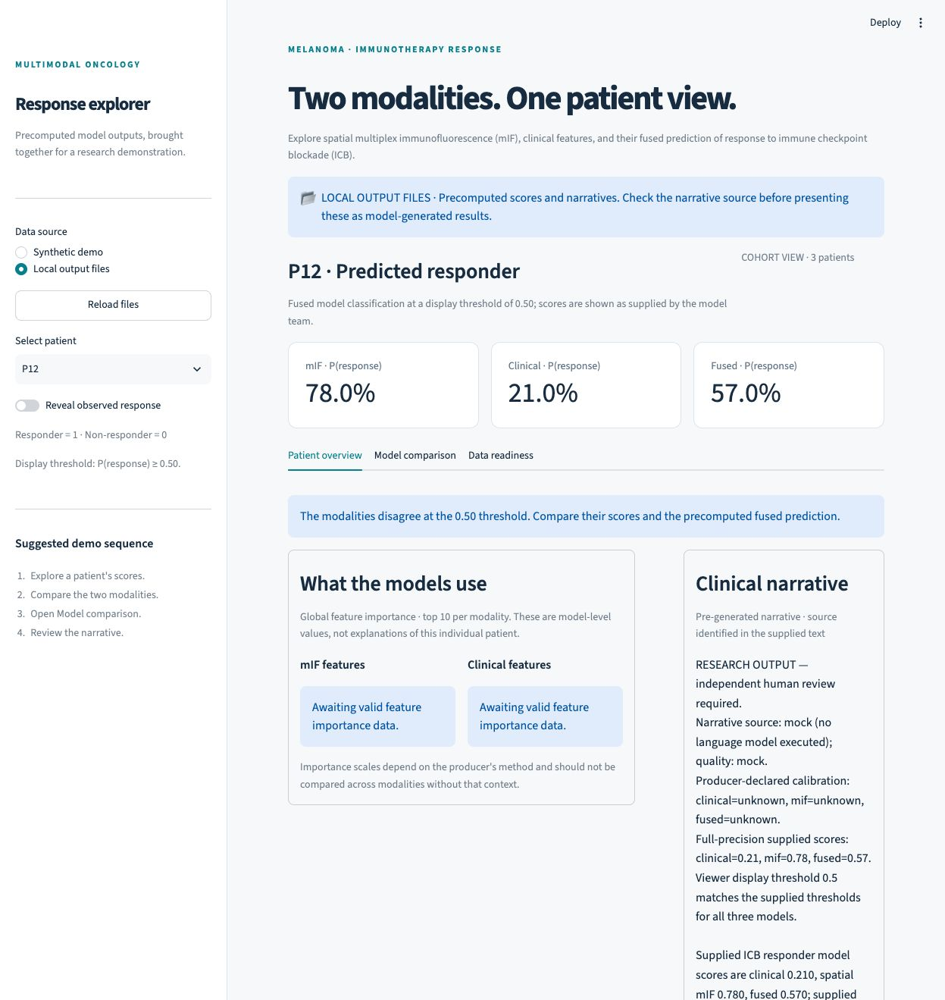

# Verified mock copilot integration

On October 13, 2026, the mock generation → UI export → Streamlit display workflow was executed using Paulo's [NVIDIA_Nemotron project](https://github.com/paulocilasjr/MyStudies_AppliedScripts/tree/c8d0f911ee99149dc1688214fed57140a0695e29/NVIDIA_Nemotron), commit `c8d0f911ee99149dc1688214fed57140a0695e29`.

This is an interface check with synthetic inputs and a deterministic mock backend. No Nemotron weights were downloaded and no GPU language model was executed. The result does not establish predictive performance or real-model narrative quality.



## Outcome

- Paulo's existing suite: **97 tests passed**.
- This UI's existing suite: **15 tests passed**, including corrected test isolation when local result files are already present.
- Mock generation produced all four supplied patients, with `narrative_source=mock` and `quality.status=mock`.
- The completed-run verifier passed the input fingerprint, patient IDs/order, preserved evidence, source/quality, review flags, and artifact checks.
- Export produced three patients for the current complete-score UI contract. Patient P07, which has only a clinical score, was explicitly excluded in `ui_export_manifest.json`; its original structured result remains available.
- Automated UI checks verified every included patient's displayed scores and exact narrative, patient switching, reload stability, unknown observed labels, and empty optional panels. Browser checks confirmed the imported patient list, concordant and discordant patient views, and the unavailable ROC message.

| Patient | mIF score | Clinical score | Fused score | Display |
| --- | --- | --- | --- | --- |
| P12 | 0.78 | 0.21 | 0.57 | Included; modality disagreement |
| P29 | 0.53 | 0.49 | 0.51 | Included; modality disagreement |
| P48 | 0.79 | 0.85 | 0.82 | Included; modality agreement |
| P07 | Missing | 0.66 | Missing | Excluded by the current UI contract |

Scores are copied unchanged from the input fixtures. All outcome labels are unknown, so ROC is unavailable. The exporter does not supply global feature importance or tile predictions; their panels correctly remain empty. The UI's own 19 synthetic fixtures are a separate dataset and were not mixed into this bundle.

## Review and corrections

The reviewed generation/export path has no blocking issue for this small, single-user mock workflow. Input validation rejects duplicate IDs and invalid scores; generation preserves supplied predictions; export records missing-modality exclusions and protects nonempty output directories from overwrite.

Two issues in the UI were corrected during integration:

1. **Misleading data-source text.** Importing a mock-generated bundle used to show “Real model outputs” and a generic Nemotron caption. The selector now says **Local output files**, and the narrative caption does not claim real model execution. The supplied narrative retains its explicit mock/fallback/model source and quality information.
2. **A test depended on an empty checkout.** The missing-file test failed after local result files were installed. It now uses an isolated temporary project without a prediction file, so adding valid local outputs does not make the test fail.

No changes were made to Paulo's source code. The exporter still requires all three scores and a supplied threshold of 0.50. Incomplete modalities or different thresholds need an agreed UI-contract extension before they can be displayed; they must not be filled or changed just to pass export.

## Repeat the workflow

Keep the two checkouts as sibling folders. The following commands assume the directories are named `MyStudies_AppliedScripts` and `melanoma-demo-ui`. Run each experiment/export into a new or empty directory.

From Paulo's `NVIDIA_Nemotron` folder, using Python 3.11 or newer:

```bash
bash scripts/run_local.sh --output-dir results/mock-run-001

PYTHONPATH=src python3 -m nemotron_copilot verify-run \
  --input examples/mock_predictions.jsonl \
  --output-dir results/mock-run-001 \
  --require-synthetic

PYTHONPATH=src python3 -m nemotron_copilot export-ui \
  --run-dir results/mock-run-001 \
  --output-dir results/ui-bundle-001 \
  --input examples/mock_predictions.jsonl
```

From a fresh UI checkout, after installing `requirements.txt`:

```bash
python3 -c 'import shutil; shutil.copytree("../MyStudies_AppliedScripts/NVIDIA_Nemotron/results/ui-bundle-001", "results/predictions")'
streamlit run src/app.py --server.port 8501
```

`copytree` intentionally fails when the destination already exists. Review/archive the old local bundle or use a fresh checkout instead of merging files; merging could leave stale optional heatmaps or importance files.

Choose **Local output files**, then **Reload files**. The patient selector should contain P12, P29, and P48. The narrative should explicitly identify mock generation. P07 should not appear, and ROC/global-importance/tile panels should show their missing-data messages. All copied run artifacts remain local under the Git-ignored `results/` directory.

## Files to preserve

- The original copilot run: `narratives.jsonl`, `narratives.csv`, `manifest.json`, `metrics.json`, and `report.md`.
- The UI bundle: `patient_predictions.csv`, `narratives.json`, `copilot_results.jsonl`, `copilot_manifest.json`, and `ui_export_manifest.json`.

Only the prediction CSV and narrative JSON are required for this viewer. Keep the sidecars for review of provenance, exclusions, and the original structured evidence.

## Not verified

Real Nemotron/vLLM execution, A30/SLURM setup, real patient data, model training, calibration, or clinical correctness. Those require separate validation in the approved compute environment. This test confirms the mock file workflow and the current UI contract.
